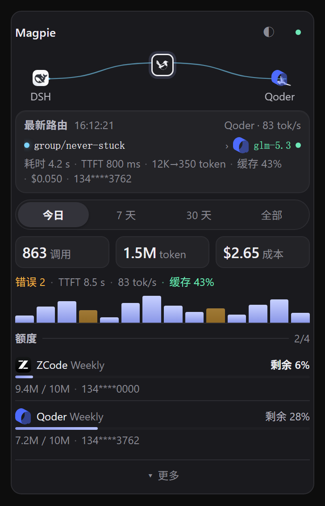
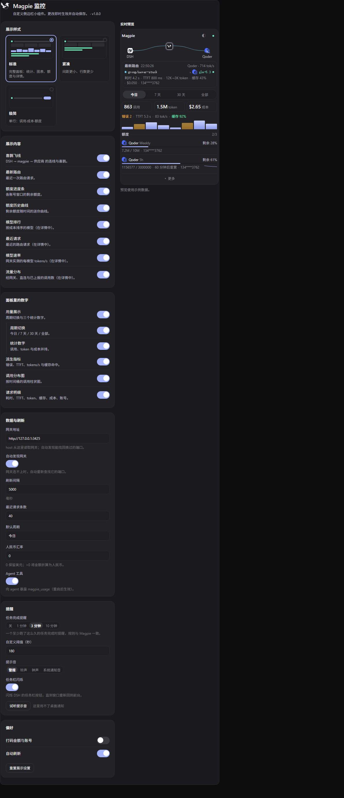

# dsh-magpie-monitor

[](https://github.com/msudustin/dsh-magpie-monitor/actions/workflows/ci.yml)
[](LICENSE)
[](package.json)
[](https://github.com/deepseek-ai)

> **Your Magpie gateway, at the bottom of the DSH sidebar.** Routing as it
> happens, spend and tokens for the period, the quota windows that actually
> matter, model speed and the harness → gateway → provider flight strip — in
> one footer widget that stays out of the way.
>
> Package `@local/dsh-magpie-monitor` · v1.6.11 · MIT · Node.js >= 22 · read-only

<p align="center">
  <picture>
    
  </picture>
</p>

<p align="center"><sub>
Rendered from the shipped <code>client.js</code> by <code>tools/preview.mjs</code>
(sample data, Chinese locale — the widget follows the DSH language setting).
</sub></p>

**At a glance**

| | |
| --- | --- |
| **Live routing** | the newest request as the gateway's own request line — session, group/route, provider, served model, status, duration, TTFT, tokens, cache hit, throughput, cost |
| **Period usage** | today / 7 d / 30 d / all-time calls, tokens and cost with an hourly bar chart and a derived line (errors, avg TTFT, tokens/s, cache hit) |
| **Quotas** | the most-used subscription windows as `provider · window … remaining %`, a 3 px track, `used / limit`, the reset countdown and the account |
| **Speed & split** | per-model throughput as the gateway measured it, and how many calls went *through* the gateway, *direct* or were *reported* upstream |
| **Display** | three styles (standard / compact / minimal), nine individual blocks, mask amounts and accounts, pause the refresh |

**Quick start**

```text
plugin_manager action=install_bundle target=github:msudustin/dsh-magpie-monitor
```

Restart DSH (the client bundle is cached until restart), open
**Settings → Magpie** and pick a style. Full details under [Install](#install).

## Screenshots

The settings page — three display styles, every block on its own switch, and a
live preview that falls back to sample data when no gateway is reachable
(**Settings → Magpie**, or **Settings → Plugins → Configure**):

<p align="center">
  
</p>

When the sidebar is collapsed, the footer becomes a single magpie mark with a
live status dot and a summary tooltip; clicking it opens a small popup with
usage, rate and the two most-used quotas.

## Panel detail

- **Live routing** — the newest request as the gateway's own request line:
  `time · session dot · group/route › provider badge · served model · status`,
  with a second line of duration, TTFT, tokens, cache hit, throughput and cost.
  Expand to see the last few requests, grouped **by request or by session**.
- **Usage by period** — today / 7-day / 30-day / all-time calls, tokens and cost, with a
  per-bucket mini bar chart and a derived-metrics line (errors, avg TTFT,
  tokens/s, cache-hit %).
- **Account quotas** — the most-used subscription windows as `badge · provider ·
  window … remaining %`, a 3px remaining track, the raw `used / limit`, the reset
  countdown (ISO stamps from the gateway are kept, not flattened to `null`), the
  account and a remaining-% sparkline; expand for more accounts.
- **Model cost ranking** — the top models by cost for the selected period.
- **Model speeds & traffic split** — per-model throughput as the gateway
  measured it (`tokens/s`, TTFT) and how many calls went *through* the gateway,
  *direct* or were *reported* upstream (details block, period-scoped).
- **Flight strip** — `DSH ●──magpie──▶ Ⓠ Qoder` under the header, drawn from the
  same data: the harness's own app icon on the left, the magpie mark on the hub,
  the provider's mark on the right, and the wire carries flowing dots while the
  widget is polling a reachable gateway. Two magpies fly the arc between harness
  and provider, faster when a request arrived in the last 30 s; one carries the
  request out, the other brings the answer back mirrored and ringed — one bird
  each way, never two on the same heading. While they
  are in the air the wire is drawn solid instead of dashed, and it goes back to
  dashed the moment they land — the same signal as the flowing dots, one level
  louder. The hub mark is pinned to the middle of the strip, on the apex of the
  arc, and carries no caption of its own: the two birds swing *under* it on two
  lanes (y 31 out, y 40 back) rather than flying through it, so the mark always
  reads as a mark and never as a bar across the line. Both ends of the wire are
  measured, not assumed: each mark is centred under its own label, so a long
  provider name pushes the right mark inward and a fixed inset would draw the
  line straight past it. `useMarkEdges` reads the two marks' centres and the
  strip builds its geometry between them, with the padding inset only as a
  fallback. The two outside
  labels carry the squeeze — a long provider name ellipsises (its full name is
  the node's tooltip) instead of running into the hub. Idle gateway
  → the birds park and the wire goes quiet, so it reads as live state rather than
  decoration.
- **The bird that flies** — not the app icon moved along a line. Routing draws a
  magpie to fly (`assets/plugins/routing/client.js` in the app bundle): a body, a
  tail, a belly, and a near and a far wing that beat from the shoulder
  (`@keyframes rtflap` — down hard, up easy), with the packet held at the tip of
  its beak. The strip copies those proportions into `FLIER` and beats the wings
  with `@keyframes mgp-flap` at the same .42 s; `animateMotion` walks it down the
  wire. `icons/magpie.svg` is still the parked mark: the header, the hub node and
  the plugin icon.
- **Collapsed rail** — when the sidebar is collapsed, a single magpie icon with a
  live status dot and a summary tooltip; clicking it opens a small popup with
  usage, rate and the two most-used quotas.

The widget auto-refreshes (default every 5 s) and can be paused, masked
(amounts / accounts → `••••`), or refreshed manually from its header. The chosen
period, mask and auto-refresh state survive a reload.

A dedicated **settings page** (like `dsh-cost-meter`) lets you pick the display
style and choose which blocks to show, with a live preview — see
[Settings page](#settings-page).

## Privacy

- **Read-only, local-only.** The host half registers `GET` routes; nothing is
  written back to the gateway or to DSH. The browser never talks to the gateway
  directly — every read goes through the DSH node process on loopback.
- **No telemetry, no CDN, no remote assets.** Provider marks and the magpie are
  inlined SVGs from `icons/`; the widget makes no request outside
  `gatewayUrl`.
- **Other tabs cannot read it.** The same-machine gate refuses a cross-site
  `Sec-Fetch-Site` and a mismatched `Origin`, so a random web page cannot use
  your local DSH server as a usage oracle.
- **What is stored:** display preferences only (`localStorage`
  `dsh-magpie-monitor:display:v1`, whitelisted on read). Usage data stays in
  memory and is dropped on reload.
- **Masking:** the header's eye toggle replaces amounts and account numbers
  with `••••` for screenshots and screen sharing.

## FAQ

**The widget does not appear after install.** Restart DSH. The host half
reloads on install, but the client bundle is cached by the module loader until
restart; a page refresh alone is not enough.

**It says the gateway is unreachable.** Check that Magpie is running and that
`gatewayUrl` matches its port. If the port moved, leave `discover` on — the host
reads `~/.config/magpie/gateway.json` and remembers the new base.

**Costs are in USD but I think in CNY.** Set `cnyRate` (e.g. `7.2`) in the
plugin config; every money figure is converted once, in one place.

**Where do I change the blocks?** Two entries open the same page:
**Settings → Magpie** and **Settings → Plugins → Configure**. Changes apply to
the footer immediately and survive a reload.

**Why do the numbers differ from the gateway dashboard?** The panel shows the
merged snapshot for the selected period, refreshed every `refreshMs` (5 s by
default); the dashboard may be a few seconds ahead or scoped differently.

## Architecture

The Magpie gateway (`http://127.0.0.1:3425` by default) sends no CORS headers,
so the browser cannot call it directly. The host half registers three read-only
routes on the DSH web server:

| Route | Purpose |
| --- | --- |
| `GET /magpie-monitor/api/config` | Effective settings + resolved currency |
| `GET /magpie-monitor/api/data?path=<key>` | Proxy one whitelisted upstream payload (`root`, `usage`, `requests`, `quotas`, `history`, `statusline`, `route`, `trace`, `models`) |
| `GET /magpie-monitor/api/snapshot?period&recent[&fresh=1]` | One merged, trimmed snapshot (health + usage + series + quotas + history + models + requests + speeds + channels + problems) so the client makes a single request per cycle |

Query parameters are forwarded **per endpoint**, not from one flat allow-list:
each upstream path declares which keys it accepts and which it requires
(`QUERY_RULES` — e.g. `requests` takes `limit`/`offset`/`period`, while `route`
and `trace` require `session`). Anything else is dropped, and a missing required
key is a `400`. The routes are not an open proxy.

Every route first passes a **same-machine gate**: the `Host` header must be a
loopback literal, `Sec-Fetch-Site: cross-site` is refused, and a present
`Origin` must match the `Host` — so a web page in another tab cannot read your
usage through the local server.

The snapshot endpoint fetches `usage` as the required core and the rest with
`Promise.allSettled`, so a slow or failing secondary endpoint degrades to a
`problems[]` entry — `{what, code, message}` — instead of blanking the widget.
Failures are **classified** (`connection`, `timeout`, `unauthorized`,
`forbidden`, `rate_limited`, `server_error`, `bad_request`) and the client
translates the code into a sentence, so a raw host string never reaches the
panel. Per-endpoint timeouts (usage/models 8 s, requests 12 s, quotas 16 s) and
a 1.5 s shared cache (`fresh=1` bypasses it) keep it cheap; the request is
aborted if the client disconnects.

**One read per burst.** Callers that arrive while a read is in flight (the
footer tick, a manual refresh, the settings preview, the `magpie_usage` tool)
join that read instead of starting their own, and the entry is stored under the
base it actually came from. A caller that goes away only drops itself: the read
is aborted once nobody is left waiting, so a disconnected panel cannot cancel a
read another caller is still sharing.

**Port discovery.** Magpie's port can move (tray restart, another profile). When
the configured base refuses a connection, the host reads `~/.config/magpie/gateway.json`
(the gateway's own report: `{"addr":"127.0.0.1:3425","pid":…,"version":…}`),
tries that base, and remembers it for later requests. `MAGPIE_URL` /
`MAGPIE_BASE_URL` win over the file, HTTP errors are never retried elsewhere
(only connection/timeout failures are), and `discover=false` pins the configured
URL as the only candidate. The file is read at most once per 4 s discovery
window, so a fast refresh cycle never hits the disk on the request path; a
connection failure clears the memo, so a port that moved is still picked up on
the very next attempt.

## Config

| Key | Default | Meaning |
| --- | --- | --- |
| `gatewayUrl` | `http://127.0.0.1:3425` | Magpie gateway base URL (http/https origin only) |
| `refreshMs` | `5000` | Widget auto-refresh interval (1000–120000 ms) |
| `requestLimit` | `40` | Rows requested for the routing list (5–200) |
| `period` | `today` | Default usage period (`today` / `7d` / `30d` / `all`) |
| `cnyRate` | `0` | USD→CNY rate; `0` keeps USD, `>0` converts every money figure once |
| `discover` | `true` | Re-discover the gateway port from `~/.config/magpie/gateway.json` when the configured base refuses connections |
| `tool` | `true` | Register the `magpie_usage` agent tool (read at apply; restart to change) |

All keys are live-updatable (`.volatile()`); the host unwraps `{get()}`
references before use.

## Agent tool

When `tool` is on, the host registers **`magpie_usage`** — a read-only,
concurrency-safe tool that returns the same merged snapshot as a Chinese text
report (calls, cost, tokens, quota windows, model ranking, recent requests).
Parameters: `period` (`today`/`7d`/`30d`/`all`, defaults to the panel setting) and
`recent` (1–50, default 5). It shares the snapshot cache with the panel.

## Look and feel

The panel borrows the gateway dashboard's own language rather than inventing one:
background `#1a1a1e`, cards `#232327`, insets `#1f1f23`, hairlines `#2d2d32`,
text `#ededf1` / `#b9b9c1` / `#8b8b94`, and the accents the dashboard uses —
lavender `#a5b4fb` for tracks and numbers, mint `#6ee7b7` for the served model
and cache hits, cyan `#7cd3fc` for the session dot.

It is a sidebar, so the palette stays quiet: **one hue per meaning**. Every quota
bar is the same lavender ramp and a thin share is said with brighter type
(`剩余 6%` in `--mgp-ink` at 600 weight), not with red or amber bars; chart bars
that carry errors are the base lavender with a translucent amber wash rather than
a second bright colour. Request status dots are mint only while the request is
fresh (under 90 s) and fall back to the muted ink afterwards, and the header dot
turns the same muted ink when auto-refresh is paused — a settled request is not a
green light.

Every provider chip and the magpie itself are the app's **real marks**, not
lookalikes: `icons/` holds the files lifted out of `magpie.exe` (the asset zip at
the end of the binary, `assets/icons/*.svg|png`) plus the QwenWork plugin icon
magpie keeps in `~/.config/magpie/icons`. `tools/embed-icons.mjs` bakes them into
`client.js` as data URIs between the `// <icons>` markers, because the client
plugin has no static asset route; run it after replacing a file in `icons/`.
Monochrome marks (`fill="currentColor"`) get an explicit fill so they read on the
dark surface. A provider with no shipped mark falls back to a tinted initial —
never to an invented shape. The left-hand node of the flight strip is DSH —
DeepSeek Harness — and wears that app's own icon (`icons/dsh.png`, cropped from
`resources/icon.png` of the DSH install), not a generic dot.

Every colour reads a DSH theme variable first and falls back to the literal above,
so the panel still follows the host theme when it is not the dark default.
Period switching is a segmented control (track + active pill), not three filled
buttons.

**It fits the sidebar at exactly the widths the host allows.** The layout plugin
clamps the left column to 264..420 px (`clampWidth(sidebar, 264, 420)`) and the
sidebar pads it by `--dsh-sidebar-inline-padding: 12px` a side, so the footer
action slot hands this panel 240..396 px; collapsed, the rail is 56 px wide with
10 px of padding and the widget shrinks to a 30 px icon. Those are the only sizes
worth checking, and nothing is drawn in one fixed coordinate space. The flight
strip measures its own box (`useBoxWidth`) and rebuilds the wire in those pixels —
the line meets both marks, the magpie hub rides the apex between the two lanes, and
the birds duck under it on their own lanes — instead of letterboxing a 320-unit `viewBox` (which
left the line short of the marks when wide and squeezed it when narrow). The
panel adapts intrinsically, with no container query anywhere in it: the mark
labels shrink and ellipsize, and the three usage cells wrap their label under the
value (`flex-wrap` on `.mgp-tcell`) instead of cutting `1.5M token` to
`1.5M to…`. That is deliberate — an earlier revision made the panel its own query
container (`container-type: inline-size`), and because the sidebar slot lays the
footer out shrink-to-fit, containment collapsed the whole widget to 8 px wide and
the panel printed one character per line. The panel also states its own width
(`width: 100%; min-width: 0`) and styles nothing outside itself: rules such as
`:has(> [data-slot="sidebar.footer.action"] > .mgp-footstack)` reached into the
host's footer wrapper and were what kept the widget narrow at maximum width.
Never give this panel a containment context, and never style the host around it;
let flexbox do the fitting. In the latest-request row the label+time group and
the provider column each clip with an ellipsis (`min-width: 0` plus
`overflow: hidden`), so a long model name never prints on top of the provider
name. `tools/preview.mjs` renders one panel at a chosen width —
`MGP_ONLY=panel MGP_W=260 node --experimental-vm-modules tools/preview.mjs
w260.html` — which is how those widths were checked.

## Client behavior

- **One request per cycle** — the client fetches `/api/snapshot` and renders
  health, usage, quotas, models, requests, speeds and channels from it; config is
  re-read each cycle so live setting changes are picked up.
- **Persistence** — the last good snapshot plus prefs (period / masked / auto)
  are stored in `localStorage` (`dsh-magpie-monitor:v1`, throttled to 15 s).
  On load the envelope is version-checked and **rebuilt through a whitelist**
  (`sanitizeSnapshot`), so a tampered or stale store cannot inject fields or
  markup. The widget shows the cached snapshot instantly, then refreshes.
- **Stale, not blank** — a failed refresh keeps the last good data and shows a
  "last succeeded at …" banner that names the reason in the panel's language
  (`connection`, `timeout`, `rate_limited`, …), never the host's raw sentence;
  only a first-load failure shows the offline banner with retry.
- **Backoff while down** — with auto refresh on, consecutive failures double the
  cycle (5 s → 10 s → 20 s → 40 s → 60 s) instead of hammering a dead port, and
  the first good read drops straight back to `refreshMs`. A manual refresh always
  goes out immediately.
- **Density** — the height cap (`min(38dvh, 320px)`) is measured from the
  viewport and mapped to `normal` / `tight` / `short`, which scales spacing,
  chart height and row counts so the session list and settings row stay visible.
- **One status control** — the header carries a single merged control instead of
  a separate dot + auto button + refresh button. Its dot reports the state
  (pulsing green = live, amber = auto refresh paused, red = gateway offline) and
  clicking it always refreshes now (`fresh=1`). While the gateway is simply
  live the control is only that dot — no pill, no word — and the words come back
  only when they explain something (`paused`, `offline`, `updating`). The
  auto-refresh switch itself lives on the settings page, and the header shows no
  logo badge and no version number: name, mask, state.
- **Output rate on the latest route** — the latest-route line shows the served
  model's throughput (`out / (ms / 1000)` → `N tok/s`) rather than wall-clock
  duration; the tooltip still carries TTFT.
- **Full-width blocks** — every block stretches to the sidebar's usable width
  (`.mgp-footstack > *{width:100%}`, `minmax(0,1fr)` grids), and long model names
  wrap instead of being ellipsised, so nothing is clipped in a narrow rail.
- **Readable floor** — data text never drops below 12px; the three usage values
  keep their larger scale. Interactive controls keep a 24px hit area.
- **Visibility** — refreshes immediately when the tab becomes visible and
  persists when hidden; in-flight fetches use `AbortController` and are cancelled
  on unmount. Manual refresh is serialized (a queued manual refresh wins over
  the auto cycle).
- **Readable failures** — a `problems[]` entry is rendered as
  `"{what}读取失败：{translated code}"`; the panel never shows a raw host string
  or a stack, and the last good numbers stay on screen.
- **Rail popup** — in the collapsed rail the icon is a real button
  (`role=button`, Enter/Space); it opens a `role=dialog` popup with usage, rate
  and the two fullest quotas, rendered through `createPortal` on `document.body`
  so the sidebar's transform cannot clip it. Closes on outside pointer or Escape.

## Settings page

One settings component is exposed through **two entries** (the `dsh-cost-meter`
pattern), so you can reach it from either place:

- **Settings → Magpie** — a `settings.section` entry (id `magpie-monitor`,
  order `35`).
- **Settings → Plugins → `@local/dsh-magpie-monitor` → Configure** — a
  `plugins.bundle.config` entry keyed by the package name (`view: 'page'`).

Both render the same `MagpieSettings` component:

- **Display style** — three radio cards with miniature previews: `standard`
  (full footer), `compact` (forced tight density, denser spacing) and `minimal`
  (a single summary line: period calls · cost · top quota).
- **Content blocks** — nine independent toggles: flight strip (the DSH → magpie →
  provider lane and its birds), latest route, usage stats, quota bars, quota
  sparklines, model ranking, recent requests, model speeds and traffic split.
  Each gates the matching block in the footer.
- **Numbers in the panel** — one parent switch for the usage section (period
  tabs + the three totals), with its two parts as an indented second level, then
  three peers: derived metrics, the activity chart, and the request meta line
  (duration, TTFT, tokens, cache, cost, account). Turning the parent off greys
  the children out and keeps the section without its numbers.
- **Short sidebars** — the panel never grows the sidebar footer. Its height is
  capped at `min(50dvh, 440px)` and the blocks inside never shrink
  (`flex:0 0 auto`), so extra rows — quota windows, the expanded request list —
  scroll inside the panel (`min-height:0` + `overflow:auto`) instead of pushing
  the sidebar's own content up. The cap is viewport-relative on purpose: a
  percentage would resolve against the content-sized footer slot, i.e. against
  the panel itself, and let it grow without bound.
- **Stamps** — the gateway sends request times as ISO text with seven fraction
  digits (`2026-11-16T13:26:45.2318564+08:00`), its request table sends epoch
  milliseconds, and quota windows may use either. The host normalises every one
  of them and the client parses the result, so a row keeps its clock, its
  freshness dot and the flight strip's live state instead of silently going idle.
- **Preferences** — mask amounts/accounts and auto-refresh (shared with the
  footer header buttons), plus a reset that restores style + blocks but keeps
  mask/auto.
- **Live preview** — the right column renders the *same* `MagpieBody` presenter
  the footer uses, fed by a fixed `SAMPLE_SNAPSHOT`, so every style/toggle change
  is reflected immediately without a fetch or iframe.
- **Host configuration** — `gatewayUrl`, `refreshMs`, `requestLimit`, `cnyRate`,
  default `period`, `discover` and `tool` are edited through the client
  `configForms` service (namespace `magpie-monitor`), persisted host-side via
  `remote.settings.mutate`. Numeric fields commit on blur/Enter and are clamped
  to the host ranges; if the namespace is not served the form degrades to a
  localized "unavailable" note while the display settings keep working.

Display style, block visibility, mask and auto live in a small module-level
store persisted to `localStorage` (`dsh-magpie-monitor:display:v1`, whitelisted
on read). The store is shared by the footer and the settings page, so a change
in either takes effect in the other instantly and survives a reload. The
`configForms` dependency is declared in the client factory `inject`
(`['slots', 'locale', 'configForms']`); the service is provided by the core
`ui-settings` client plugin, which is always present in the web GUI.

## Install

From the package directory, via the Harness plugin manager
(`plugin_manager install_bundle`), which adds the dependency and applies
`cordis.patch.yml` to the profile. The client bundle registers three slots:
`sidebar.footer.action` (id `magpie-monitor`, order `100`, the last footer
action just above the settings row), `settings.section` (id `magpie-monitor`,
order `35`) and `plugins.bundle.config` (key `@local/dsh-magpie-monitor`). The
footer uses scoped `:has()` rules to claim a full-width row without growing any
ancestor. **Restart DSH** to load the client half — the module loader caches the
client bundle until restart, so a page refresh alone is not enough. The host
half (routes + tool) reloads on install.

Install it straight from GitHub (the plugin manager understands the `github:`
shorthand and clones the repository):

```
plugin_manager action=install_bundle target=github:msudustin/dsh-magpie-monitor
```

Or clone it and point the manager at the checkout:

```bash
git clone https://github.com/msudustin/dsh-magpie-monitor.git
# target = <clone>/dsh-magpie-monitor
```

Requirements: Node.js >= 22, a running Magpie gateway (default
`http://127.0.0.1:3425`), and `@deepseek-ai/schemastery` `>=3.18.4 <4` provided
by the DSH profile (it is a peer dependency, not a bundled one).

## Robustness

- **Error boundary** — the footer component is wrapped in a stable, module-level
  React error boundary, so a render error shows a localized, retryable fallback
  instead of taking down the sidebar foot.
- **Gateway identity check** — "online" requires the root payload to report
  `name === 'magpie'`, not merely an open port; the version is surfaced too.
- **No-store + nosniff** — every host response sets `Cache-Control: no-store`
  and `X-Content-Type-Options: nosniff`; routes are GET-only.
- **No secrets** — the host reads one file (the gateway's own `gateway.json`
  report, for the port) and forwards no credentials; the client only ever calls
  same-origin routes.
- **Bounded detail reads** — `/api/data` aborts its upstream fetch when the panel
  closes the request, and refuses an endpoint that needs a parameter (`route`,
  `trace` need `session`) with a `400` instead of forwarding an empty query.

## Offline preview

```
node --experimental-vm-modules tools/preview.mjs [out.html]
```

Runs the **real** host `apply()` in-process against the live gateway, loads the
**real** client bundle in a `vm` context, and writes one self-contained
`preview.html` (default `dsh-magpie-monitor/preview.html`) — no DSH restart, no
browser automation.

The markup is rendered by the shipped components, not by a parallel mock: the
snapshot is seeded into the widget's own `localStorage` cache, a small React shim
calls the registered slot components, and the element tree is serialized to HTML.
A hand-written mock drifts; this cannot.

| env | effect |
| --- | --- |
| `MGP_ONLY=panel\|rail\|settings` | render one surface instead of all three |
| `MGP_W=340` | frame width for the surface under test |
| `MGP_CLIENT=.tmp_client.js` | render a variant bundle (e.g. force `expanded`) |
| `MGP_STYLE=minimal` | seed the display style (standard / compact / minimal) |
| `MGP_DUMP=1` | also write `.tmp_panel.html` and `.tmp_snapshot.json` |

Add `?diag=1` to the preview URL to append an overflow report (any element wider
than its frame) to the page — useful when checking a narrow sidebar width.

## Tests

```
npm test
```

(equivalently: `node --experimental-vm-modules --test --test-force-exit "test/*.test.js"`)

91 tests: host integration (real `index.js` in a `vm` module with a stubbed
schemastery, fake webServer/tools and mock fetch — including the same-machine
gate, per-endpoint query rules, failure classification, port discovery and the
"HTTP errors are not retried elsewhere" rule, in-flight read sharing, the
discovery memo and a detail read that aborts with its caller), client mount
(real `client.js` against a fake React hook scheduler that enforces the hook
order, fake DOM/localStorage/timers — covering the footer and the settings page:
style selection, content toggles, reset, host config editing via a fake
`configForms`, footer/settings shared state, the merged status control's
live/paused/compact behaviour, speeds/channels readouts, translated problems,
the failure backoff curve and the rail popup's open/Escape cycle), and
source-level invariants (negative regexes for eval/innerHTML/external URLs/
secrets, whitelist guards, single refresh affordance, 12px type floor, trust
gate, failure-code contract, portal usage, manifest shape), and layout (the wire
is rebuilt from the measured strip at 260/320/480 and from the measured marks
when a long label pulls one inward, the hub is the strip's own child painted
after the wire, the birds take one lane each and fly opposite ways, the panel is
never a containment context, and the latest row clips instead of overlapping its
meta column).

## Borrowed ideas

v1.1 folds in the best of two community Magpie plugins (both MIT):

- **[todayT/dsh-magpie-dashboard](https://github.com/todayT/dsh-magpie-dashboard)** —
  snapshot caching with whitelist re-validation on read, a defensive
  normalization layer, reset/expiry wording on quota bars, a serialized refresh
  guard, and the `node:vm` fake-React mount + negative-regex test approach.
  (Its CLI/spawn/OAuth/checkin half is not portable to our HTTP gateway, and we
  avoid its hardcoded install path and dead code.)
- **[hebangwen/dsh-magpie-usage](https://github.com/hebangwen/dsh-magpie-usage)** —
  the merged host snapshot with per-endpoint timeouts and `allSettled`
  degradation, the `magpie_usage` agent tool sharing that snapshot, derived
  metrics (avg TTFT, tokens/s), density-adaptive layout, the mask toggle,
  stale-banner-with-old-data, and visible-tab catch-up.

v1.4 / v1.5 add the best of two more (both MIT):

- **[Hongcheng-LI/dsh-magpie-quota](https://github.com/Hongcheng-LI/dsh-magpie-quota)** —
  port re-discovery with a remembered base, the same-machine request gate, error
  semantics translated on the client instead of a raw host string, per-endpoint
  query rules, and the "render the real client bundle offline" preview script
  (`tools/preview.mjs`). Its upstream-API traps are worth repeating: `requests`
  pages with `offset` (not `page`), and timestamps mix `+08:00` with `Z`, so
  always `Date.parse`. We keep our own JSON error contract (never HTTP 200 for a
  failure) and do not adopt its hardcoded model-name lists or top-of-range
  `z-index`.
- **[prgrmrwy/dsh-magpie-connector](https://github.com/prgrmrwy/dsh-magpie-connector)** —
  a `locale` registration that returns its disposer (so a hot reload cannot fail
  with "already has locale"), whitespace-normalized window names with a canonical
  ordering, usage thresholds that read the same on every bar, and a rail popup
  through `createPortal` that dismisses on outside pointer / Escape. (Its
  provider-adapter half — undici transport, model routing, credential writes —
  is out of scope for a read-only monitor.)

**Measured correction:** `dsh-magpie-quota`'s CHANGELOG reports that
`/v1/magpie/usage` under-counts calls (missing local sessions, low by 2–5×).
On gateway 0.1.4245 the two endpoints agree field for field with
`/v1/magpie/usage/requests`, so `usage` stays the primary read; `requests` is
used only for what `usage` does not carry (per-model speed, channel split), and
always with the selected `period` so those numbers match the totals.

We keep our own gateway identity check, hot `.volatile()` config, origin
validation and `nosniff`, and resolve the quota `used` semantics by measurement
(the gateway reports `used` as a percentage). The client persists to
`localStorage` rather than a host disk cache: the HTTP snapshot is cheap and
credential-free, so no private file or ACL handling is needed.